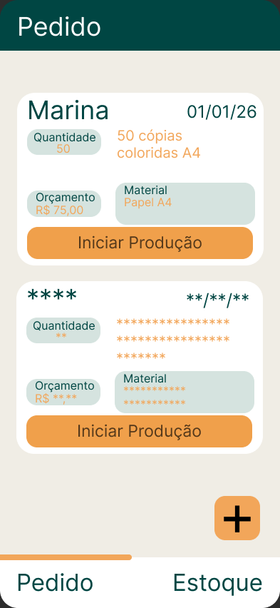
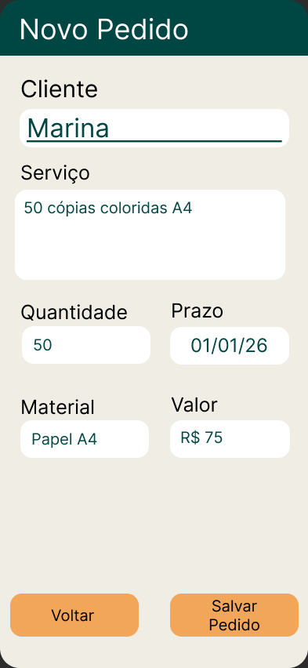
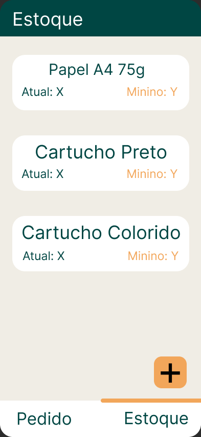
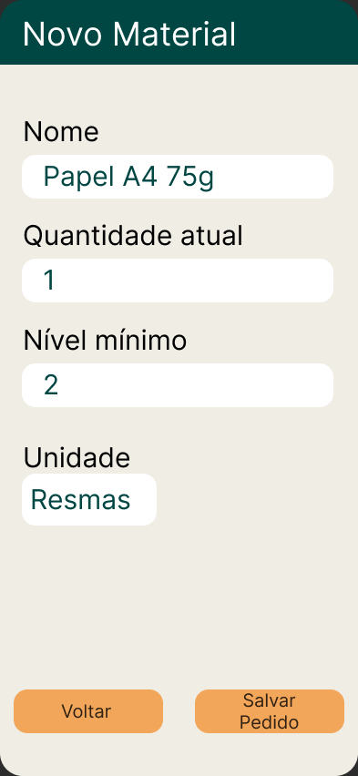

# 🎨 Aquarela Papelaria

  
  
  
  

---

## 📖 Visão Geral
A **Aquarela** ajuda as pessoas a transformarem ideias ou conceitos em produtos físicos impressos (canecas, botons, apostilas), eliminando a necessidade de deslocamento presencial para cada etapa do pedido.

> **Pitch:** Facilidade e controle na palma da mão para quem busca personalização e agilidade gráfica.

---

## 🔍 O Problema e a Solução

**O Problema:** Atualmente, quem deseja um produto personalizado precisa ir até a loja física para explicar o pedido e não possui um canal simples para acompanhar o status da produção ou seu histórico.

**A Solução:** Um aplicativo centralizado onde o usuário registra o pedido de casa, escolhe o produto e acompanha se ele está "Em aberto", "Pronto" ou "Entregue".

**Público-Alvo:** 
*   🎓 **Estudantes:** Impressão de trabalhos e materiais escolares.
*   ☕ **Presentes:** Pessoas em busca de produtos personalizados (canecas, botons).
*   💼 **Profissionais:** Impressão de planilhas e documentos.
*   **Persona de Teste:** Claudio Lucas de Farias (Dono da loja).

---

## 🖼️ Protótipo e Interface

O design foi focado na clareza e facilidade de uso para quem está na correria do dia a dia.

| Pedidos | Novo Pedido | Estoque | Novo Material |
| :---: | :---: | :---: | :---: |
|  |  |  |  |

🔗 **[Visualizar Protótipo Interativo no Figma](https://www.figma.com/design/aGKY9fQi4fqQMsaLlFerOS/Aquarela?node-id=0-1&t=5QbIWXBvJo3ShDJx-1)**

---

## 🚀 Funcionalidades (MVP)

- [x] **F1 [Essencial]** - Cadastrar/listar produtos (caneca, botom, impressão)
- [x] **F2 [Essencial]** - Criar pedido vinculado a um cliente e um produto
- [x] **F3 [Essencial]** - Listar pedidos com status (Em aberto / Pronto / Entregue)
- [ ] **F4 [Desejável]** - Buscar/filtrar pedidos por cliente ou status

**Fora do Escopo:** Pagamentos in-app, Notificações Push, Chat, Sincronização em Nuvem.

---

## 🛠️ Stack Técnico

O app utiliza a **Opção A (Room)**, salvando todos os dados localmente no dispositivo.

*   **UI:** Jetpack Compose + Material 3
*   **Dados:** [Room Database](https://developer.android.com/training/data-storage/room) + KSP
*   **Assincronismo:** Kotlin Coroutines + Flow
*   **Navegação:** Navigation Compose

---

## 👥 Equipe e Responsabilidades

| Integrante | Papel Principal |
| :--- | :--- |
| **David** | Dev / Telas e UI |
| **Eduardo** | Dev / Camada de Dados (Room) |
| **Iraquitan** | Design e Identidade Visual |
| **Arthur** | Documentação, Build e Entrega |

> **Risco Identificado:** Acesso limitado a computadores em casa. 
> **Plano B:** Uso planejado dos laboratórios da instituição.

---

## 🤖 Acordo de Trabalho com IA

1.  **Revisão Obrigatória:** Ninguém aceita mudanças do Agent Mode sem ler a mudança inteira.
2.  **Documentação:** Quem aceitou o código escreve o comentário de fronteira do arquivo.
3.  **Sincronização:** Antes de cada marco, o grupo revisa junto o que foi feito.
4.  **Segurança:** Nenhuma chave de API ou senha vai para o prompt.

---

## 📅 Cronograma de Marcos (Milestones)

| Marco | Descrição | Prazo | Status |
| :---: | :--- | :---: | :---: |
| M1 | Canvas + Repositório | 16/09 | ✅ |
| M2 | PRD + Protótipo | 30/09 | ✅ |
| M3 | Funcionalidade Base (Lista + Ação) | 21/10 | ✅ |
| M4 | Persistência Room Completa | 11/11 | ✅ |
| M5 | Identidade Visual + APK Release | 25/11 | 📅 |
| M6 | Entrega Final e Materiais de Loja | 02/12 | 📅 |

---

## ✅ Definição de Pronto (DoD)

- [ ] Estabilidade: 5 min de uso sem crashes.
- [ ] Dados Reais: Sem textos "mockados" na interface final.
- [ ] UX: Mensagens de erro claras para o usuário (o app não quebra).
- [ ] Branding: Ícone e cores próprias configuradas.
- [ ] Documentação: `AGENTS.md` e `USO_DE_IA.md` preenchidos.

---

## 📋 Informações Acadêmicas
*   **Integrantes:** Eduardo, Arthur, Iraquitan e David
*   **Turma:** 3º ano A - Ensino Médio
*   **Entrega Final:** 10/12/2026
*   **Repositório:** [GitHub - Projeto Aquarela](https://github.com/Edu1910sccp/Projeto-H-lio-)

---

<i>Projeto desenvolvido para a disciplina de Desenvolvimento Móvel.</i>

