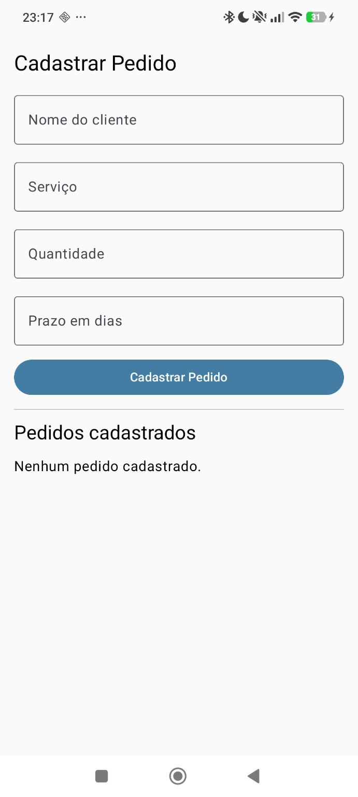
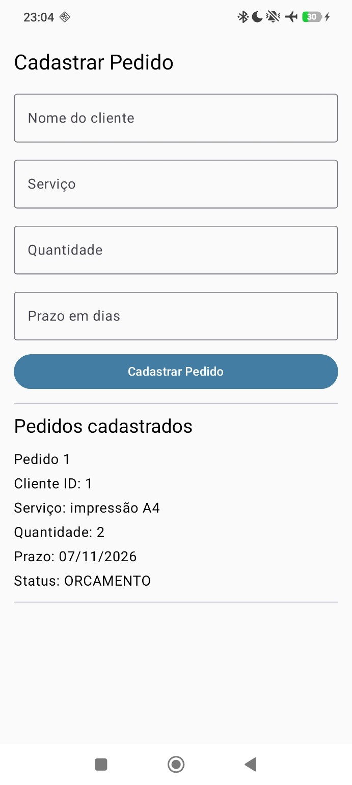
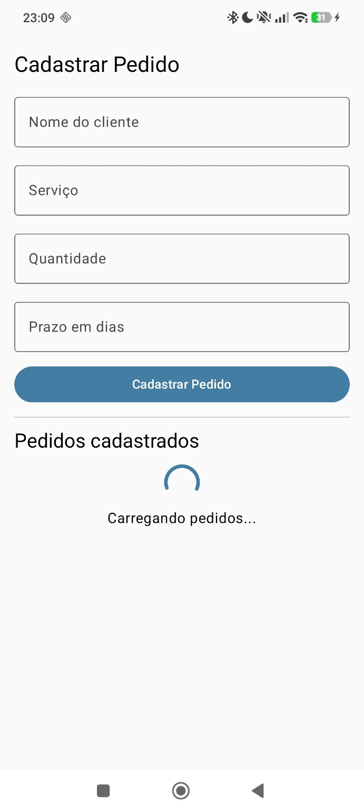
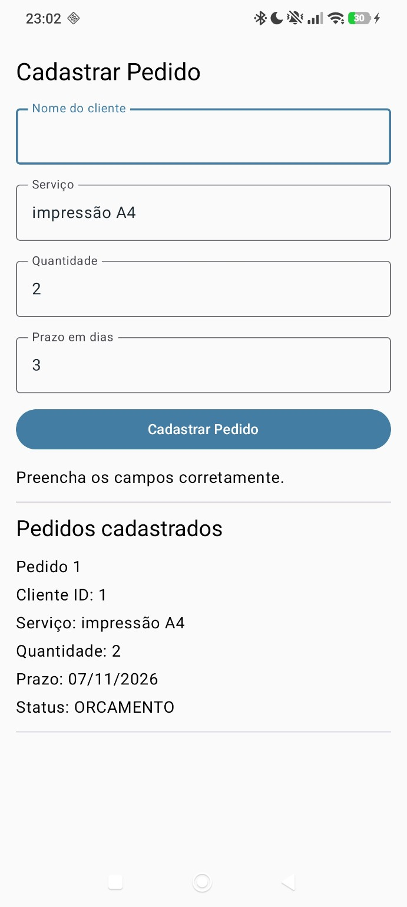
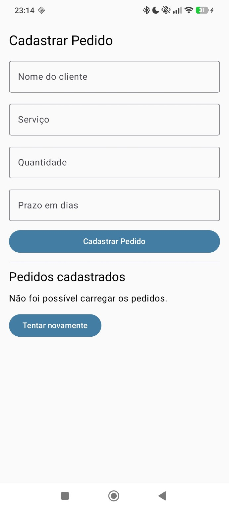
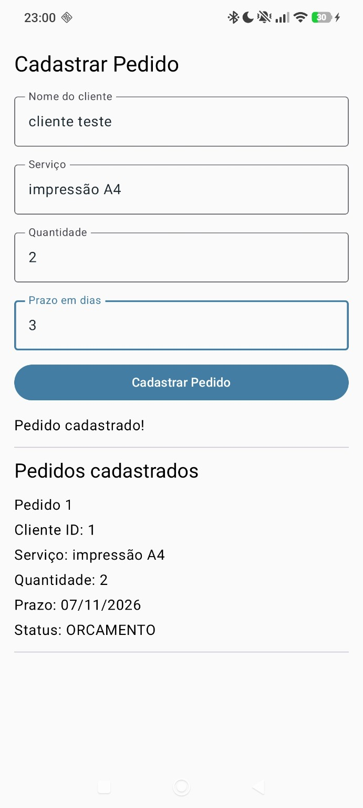

<!-- Fronteira: documentação dos cinco testes de sabotagem da Parcela 1. Registra como os estados da tela de Pedido foram provocados, o que aconteceu no celular e as evidências. Sem este documento, a entrega perde o registro verificável dos testes. -->

# Parcela 1 — Testes de sabotagem

**Projeto:** Aquarela Papelaria  
**Entidade:** Pedido  
**Ambiente de teste:** celular Android físico, Jetpack Compose e Room  
**Branch da atividade:** `feature/estados-da-tela`  
**Status:** cinco sabotagens executadas; estado Sucesso conferido separadamente

## Resumo dos resultados

| Teste | Situação provocada | Resultado observado |
|---|---|---|
| 1 | Banco sem pedidos | **Aprovado:** estado `Vazio` |
| 2 | Celular em modo avião | **Aprovado:** pedidos consultados offline |
| 3 | Atraso artificial na leitura | **Aprovado:** estado `Carregando` |
| 4 | Campo obrigatório vazio | **Aprovado:** cadastro recusado com aviso |
| 5 | Falha artificial na consulta | **Aprovado:** estado `Erro` e recuperação |
| Complementar | Cadastro válido | **Aprovado:** estado `Sucesso` |

## Teste 1 — Lista vazia (`UiState.Vazio`)

**Como provoquei:** limpei os dados locais do aplicativo de teste no celular, deixando o banco Room sem pedidos, e abri novamente o Aquarela Papelaria.

**Resultado observado:** a seção **Pedidos cadastrados** exibiu **“Nenhum pedido cadastrado.”**. O aplicativo continuou funcionando, sem fechamento inesperado.

**Resultado:** **Aprovado.**

**Evidência — tela vazia:**

## Teste 2 — Modo avião (sem conexão com a internet)

**Como provoquei:** ativei o modo avião no celular físico e consultei os pedidos previamente cadastrados.

**Resultado observado:** os pedidos continuaram visíveis na lista, sem fechar o aplicativo. Isso é compatível com o uso do banco de dados Room, que armazena os registros localmente.

**Resultado:** **Aprovado.** O modo avião não deveria, por si só, gerar um erro de rede nessa consulta local.

**Evidência — ícone do modo avião e pedido visível:**

## Teste 3 — Estado Carregando (`UiState.Carregando`)

**Como provoquei:** acrescentei temporariamente `delay(2000)` antes de consultar os pedidos na função `carregar()` do `PedidosViewModel.kt`, simulando dois segundos de espera.

**Resultado observado:** a interface mostrou o indicador circular e o texto **“Carregando pedidos...”**; depois apresentou os pedidos normalmente.

**Resultado:** **Aprovado.**

**Limpeza após o teste:** removi o `delay(2000)` e o import temporário, quando não era mais utilizado.

**Evidência — carregamento:**

## Teste 4 — Campo obrigatório vazio (validação do cadastro)

**Como provoquei:** deixei o campo **Nome do cliente** vazio e preenchi Serviço, Quantidade e Prazo em dias com valores válidos. Em seguida, toquei em **Cadastrar Pedido**.

**Resultado observado:** o aplicativo exibiu **“Preencha os campos corretamente.”** e não cadastrou um novo pedido. O pedido anterior permaneceu na lista.

**Resultado:** **Aprovado.**

**Evidência — validação:**

## Teste 5 — Estado Erro e botão Tentar novamente (`UiState.Erro`)

**Como provoquei:** inseri temporariamente, na função `carregar()`, uma exceção controlada para fazer a primeira tentativa de leitura falhar. A tentativa seguinte podia consultar o banco normalmente.

**Resultado observado:** a tela mostrou **“Não foi possível carregar os pedidos.”** e o botão **Tentar novamente**. Ao tocar no botão, a função `carregar()` realizou uma nova leitura e os pedidos reapareceram. O aplicativo continuou aberto.

**Resultado:** **Aprovado.**

**Limpeza após o teste:** removi a variável de falha única e o bloco que lançava a exceção artificial.

**Evidência — mensagem e botão:**

**Observação:** a imagem comprova a tela de erro e a presença do botão. A recuperação após o toque foi verificada durante a execução do teste.

## Verificação complementar — Estado Sucesso (`UiState.Sucesso`)

**Como verifiquei:** cadastrei um pedido válido com Cliente Teste, serviço de impressão A4, quantidade 2 e prazo de 3 dias.

**Resultado observado:** o aplicativo confirmou **“Pedido cadastrado!”** e exibiu **Pedido 1** na lista, com serviço, quantidade, prazo e status.

**Resultado:** **Aprovado.**

**Evidência — pedido cadastrado:**

## Conclusão

Os cinco testes de sabotagem foram realizados no celular físico, e os comportamentos esperados foram observados. Também foi comprovado o estado **Sucesso** com um pedido cadastrado de verdade. Os testes demonstram os quatro estados previstos para a tela (`Carregando`, `Vazio`, `Erro` e `Sucesso`), a validação de campo obrigatório e a consulta offline ao banco Room.

As alterações temporárias usadas para simular lentidão e falha foram removidas após os testes.

**Conferências antes do Pull Request:** compilar novamente o aplicativo sem os trechos temporários; verificar o tratamento dos quatro estados no `when` sem `else`; revisar os comentários de fronteira; e incluir `docs/sabotagem.md` junto com toda a pasta `docs/evidencias` nos commits.!

